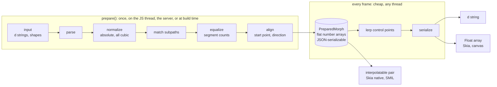
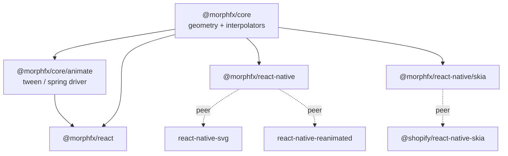
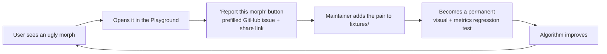

# RFC 0001: Project foundations

| | |
|---|---|
| **Status** | Accepted (2026-10-11). See the [decision log](#decision-log); a few minor items are still open |
| **Created** | 2026-10-11 |
| **Scope** | Vision, architecture, API, stack, contribution model, docs site, roadmap |

This is the first brainstorm for the project, written as an RFC so we can comment on it line by line in a pull request.
Each section ends with a **recommendation**. The [decision log](#decision-log) records what we settled; anything still undecided is in
[§13 Open questions](#13-open-questions-decisions-needed).

---

## Decision log

Decided on 2026-10-11:

| Topic | Decision |
|---|---|
| **Name** | **morphfx**. npm scope `@morphfx/*` (`@morphfx/core`, `@morphfx/react`, `@morphfx/react-native`) |
| **License** | **MIT** |
| **React floor** | **React 19** |
| **Skia packaging** | **`/skia` subpath** of `@morphfx/react-native`, with `@shopify/react-native-skia` as an optional peer dependency. We can split it into its own package later without changing the API |
| **Animation driver** | **Our own small built-in driver** (tween + spring), written in TypeScript. Motion, Reanimated, GSAP and the like remain optional integrations |
| **Rust / WebAssembly** | Considered and **deferred**: the engine stays in TypeScript for now. See [Should the engine be written in Rust?](#should-the-engine-be-written-in-rust) for the reasoning and for what would make us revisit |
| **Separate repository for the engine** | **Not now.** The engine stays in this monorepo but is published as its own package, `@morphfx/core`, which any JS project can already use on its own |
| **Defaults adopted** | The other recommendations in this RFC stand unless someone objects: ESM + CJS in 0.x, Biome, Fumadocs, Changesets, an `AGENTS.md`, English-first docs |

### Should the engine be written in Rust?

The idea is appealing: one fast engine that could be reused outside JavaScript later. We looked at where the time actually goes:

- **The built-in driver** (tween and spring) does a few multiplications per frame. Crossing into WebAssembly or a native module costs more than the arithmetic it would replace.
- **Per-frame interpolation** is one loop over a few hundred to a few thousand numbers, which JS engines compile to fast machine code. Most of the per-frame cost comes *after* it: building the `d` string, then the browser or native side re-parsing and rasterizing the path. A Rust version would also have to hand a string back across the WebAssembly boundary every frame, which adds copying and text decoding.
- **On React Native**, Hermes gained WebAssembly support in 2026, but as an early preview that isn't production-ready. It also translates WebAssembly into the same bytecode as JavaScript and runs it on the same interpreter, so it brings no speedup. Real native speed would need a native module (for example through uniffi-bindgen-react-native or Nitro Modules). That breaks Expo Go, adds iOS and Android build steps for every user, and is awkward to call from Reanimated worklets on the UI thread.
- **On the web**, WebAssembly adds asynchronous initialization, bundler configuration, SSR/edge caveats and tens of kilobytes, against a 5 kB budget for the whole core.
- **Where Rust could genuinely help:** `prepare()` on very large paths (thousands of segments, such as maps or detailed illustrations). That is a one-off cost per morph, not a per-frame one.

**Decision:** keep TypeScript and keep the door open:

1. Write the algorithm down (Concepts docs and code comments), and keep the fixture corpus **language-neutral** (SVG and JSON files with expected results), so another implementation could be validated against the same tests.
2. Benchmark `prepare()` from Phase 1 onward (CodSpeed). If real users hit a bottleneck there, prototype an **optional** accelerator (for example `@morphfx/core-wasm`) behind the same API, so nothing changes for everyone else.
3. If we later need the engine outside JavaScript (Swift, Kotlin, Flutter, game engines), a Rust port becomes worthwhile. It can live in this monorepo (a `crates/` folder) or be split out at that point.

---

## Table of contents

0. [Decision log](#decision-log)
1. [TL;DR](#1-tldr)
2. [Why this library? (landscape)](#2-why-this-library-landscape)
3. [Vision, goals, non-goals](#3-vision-goals-non-goals)
4. [How it works: the morph pipeline](#4-how-it-works-the-morph-pipeline)
5. [How it is used: API design](#5-how-it-is-used-api-design)
6. [Package architecture](#6-package-architecture)
7. [Tech stack and tooling](#7-tech-stack-and-tooling)
8. [Quality, performance, accessibility, security](#8-quality-performance-accessibility-security)
9. [Contributing and governance](#9-contributing-and-governance)
10. [Documentation and live examples website](#10-documentation-and-live-examples-website)
11. [Naming](#11-naming)
12. [Roadmap](#12-roadmap)
13. [Open questions (decisions needed)](#13-open-questions-decisions-needed)
14. [Risks](#14-risks)
15. [Appendix: glossary and references](#15-appendix)

---

## 1. TL;DR

| Topic | Recommendation |
|---|---|
| **v1 scope** | SVG path morphing for **React (web, Next.js)** and **React Native (Expo)**, built on a framework-agnostic core. Text, image and UI morphing come later but shape the abstractions now. |
| **Architecture** | 3 layers: **core** (pure TS geometry, zero deps) → **drivers** (when and how fast: tween, spring, external progress) → **bindings** (React DOM, RN + `react-native-svg`, RN + Skia). |
| **Key idea** | *Prepare once, tween cheap.* Expensive matching runs once (on the JS thread, on the server, or at build time). Each frame only does linear interpolation over a flat number array, which is fast enough for the RN UI thread. |
| **Interop** | Bring your own animation library (Motion, Reanimated, GSAP, react-spring, scroll/gesture), or use the tiny built-in driver. |
| **Monorepo** | pnpm workspaces (+ catalogs) and Turborepo |
| **Build** | tsdown (Rolldown), shipping ESM + CJS + `.d.ts`, with `isolatedDeclarations` |
| **Quality** | Vitest, fast-check property tests, visual "filmstrip" regression tests on an SVG fixture corpus, CodSpeed benchmarks, size-limit, publint, attw |
| **Lint/format** | Biome |
| **Release** | Changesets, GitHub Actions, npm Trusted Publishing (OIDC + provenance), and pkg.pr.new previews on every PR |
| **Docs site** | Next.js + Fumadocs on Vercel, with an interactive **Playground** and an "explain the algorithm" section |
| **License** | MIT |
| **Name** | **morphfx**, published under the `@morphfx` npm scope ([§11](#11-naming)) |

---

## 2. Why this library? (landscape)

Versions checked on the npm registry on 2026-10-11:

| Library | Latest release | Strengths | Gaps for us |
|---|---|---|---|
| **flubber** | 0.4.2 (**2018**) | Good results on very different shapes; the de-facto recommendation (Motion's docs use it as a mixer) | Unmaintained. Converts curves to polygons (many line segments, so curves are lost). Heavy. Types only via DefinitelyTyped. No RN or worklet story. |
| **polymorph-js** | 1.0.2 (2019) | Small; handles holes | Unmaintained; web only |
| **d3-interpolate-path** | 2.3.0 (2022) | Good for line charts where paths are similar | Not designed for arbitrary shapes |
| **GSAP MorphSVG** | gsap 3.15 (2026), free since GSAP 3.13 | Best-in-class quality on the web | Tied to GSAP and the DOM. GSAP's own license, not OSI. No React Native. |
| **KUTE.js** | 2.2.6 (2026) | Maintained | Ships its own animation engine; web only |
| **Motion** | 14.1 (2026) | Excellent React animation library | Morphs natively only when both paths have the **same commands**; it recommends flubber for different shapes |
| **RN Skia** `usePathInterpolation` | Skia 2.14 | Native, fast interpolation on the UI thread | Paths must already be *interpolatable* (same verbs and counts) |

**The gap:** nobody offers a maintained, typed, tree-shakable morphing engine that keeps curves, runs on any JS runtime (browser, Node/RSC, Hermes, Reanimated worklets), and plugs into whatever animation library a project already uses.
That is the niche to own. **Recommendation:** position the library as *the morphing engine*, not as yet another animation library.

---

## 3. Vision, goals, non-goals

**Vision:** *Morph anything into anything with one API across web and native, starting with SVG shapes.*

### Goals (v1)

1. **High-quality morphs between arbitrary SVG paths**: different command counts, different subpath counts, holes, open and closed paths. Curves stay curves (cubic Béziers) instead of being turned into polygons.
2. **One mental model** for React DOM / Next.js and React Native / Expo: same component names, props and options.
3. **Animation-library agnostic**: works with Motion, Reanimated, GSAP, react-spring, scroll and gestures, or with our tiny built-in driver.
4. **Fast**: heavy work happens once; each frame is a flat loop over a number array; on RN it runs on the UI thread.
5. **Small and tree-shakable**, with zero runtime dependencies in core.
6. **SSR/RSC-friendly**: nothing touches `window` at import time, output is deterministic, and the first frame renders on the server.
7. **Accessible by default**: honors reduced-motion settings.
8. **Great DX**: first-class TypeScript, a debug overlay, clear errors, a playground.

### Non-goals (v1)

- A general animation or timeline library. We integrate with Motion, GSAP and Reanimated; we don't compete with them.
- Our own canvas or WebGL renderer (Skia covers the native high-performance case).
- Full SVG documents (gradients, filters, masks). v1 handles paths and basic shapes; multi-element icon morphing is a later phase.
- Text, image and UI morphing (see below).

### Later morph types (influence the design now, build later)

| Type | Likely approach | Reuses core? |
|---|---|---|
| **Text: outline morph** | Font file → glyph outlines (e.g. `opentype.js`) → paths → core | Yes, fully |
| **Text: character flow** | Diff old and new strings: shared characters slide, others enter/exit (like NumberFlow) | Reuses drivers and bindings, not the geometry |
| **Image** | Crossfade + mesh warp driven by landmarks; WebGL or Skia shaders | Reuses drivers |
| **UI / layout** | Shared-element / FLIP. Platforms already have primitives (View Transitions API, Motion layout animations, Reanimated shared transitions), so our value would be a thin unified API, not a reimplementation | Reuses drivers |

**Design implication:** keep the abstractions generic. An *interpolator* is just `(t: number) => T`, and a *driver* is just "something that produces `t` over time". The SVG engine is the first `T`. Also, the brand name should not contain "svg".

---

## 4. How it works: the morph pipeline



### Steps

1. **Input.** A path `d` string, or a basic shape (`circle`, `ellipse`, `rect` with `rx/ry`, `line`, `polyline`, `polygon`) converted to a path. Later: whole SVG markup, icon-set data, glyphs.
2. **Parse.** A spec-compliant tokenizer that handles implicit repeated commands, compact numbers (`1.5.5`), exponents, and arc flags written without separators (`a1 1 0 00 1 1`). Errors point to the exact position.
3. **Normalize.** Convert everything to absolute coordinates, then turn **every segment into a cubic Bézier**:
   - `L`/`H`/`V` become a cubic with its control points at 1/3 and 2/3 of the line;
   - `Q`/`T` become an exact degree-elevated cubic;
   - `A` becomes a cubic approximation, split into arcs of at most 90°, with the spec's out-of-range radii correction;
   - `Z` becomes an explicit closing segment when the end point differs from the start.

   The result is one uniform representation: subpaths made of `start + N cubics + closed flag`.
4. **Match subpaths.** When the subpath counts differ (an "i" has 2 subpaths, an "o" has 2 including a hole, an "8" has 3), pair subpaths by a cost made of centroid distance, area and bounding box. Use the Hungarian algorithm for small counts and a greedy pass for large ones. Unmatched subpaths **grow from**, or **collapse into**, a point (the partner's centroid or its nearest point). A flubber-like "split one into many" strategy can come later as an option.
5. **Equalize.** Subdivide segments with de Casteljau until both subpaths have the same segment count. Split the longest segments first so points stay evenly distributed.
6. **Align (point correspondence).** First normalize winding on both sides (outer contours one direction, holes the other), so `fill-rule` stays correct at every `t`. Then, for closed subpaths, choose the starting offset that **minimizes the total squared distance** between corresponding points. This is O(n²) and n is small; FFT cross-correlation is possible if it ever matters. Open subpaths have a fixed start, so they only try reversal.
7. **Interpolate (per frame).** Lerp every control point: one loop over a flat array. Possible later options: *rotational* interpolation around centroids (avoids the "shrink in the middle" effect when a shape rotates) and area-preserving correction.
8. **Output.**
   - a `d` string with configurable precision (precision drives string size and per-frame cost);
   - a raw number array for Skia, canvas or WebGL;
   - an **interpolatable pair** (two paths with identical structure) that the platform can interpolate natively: Skia's `interpolate`, SMIL `<animate>`, and CSS `d` where supported.

### Prepared data is plain data

```ts
// Sketch, not final
interface PreparedMorph {
  version: 1
  layout: number[]   // per subpath: [segmentCount, closed (0|1), ...]
  from: number[]     // [x0, y0, c1x, c1y, c2x, c2y, x, y, ...]
  to: number[]
}
```

Because it is JSON-serializable, a `PreparedMorph` can be computed in a **React Server Component**, at **build time** (CLI or bundler plugin), or on the JS thread and then **copied into a Reanimated worklet**.

### How we judge whether a morph is "good"

Quality must be measurable, not just a matter of opinion:

- **Correct endpoints:** `t=0` renders exactly like the source, `t=1` exactly like the target, with no NaN anywhere.
- **Travel distance:** total anchor displacement. Lower is usually better.
- **Twisting:** self-intersections in intermediate frames. Lower is better.
- **Smoothness:** area and perimeter should change smoothly over `t`.
- **Human review:** filmstrip images (`t = 0, .25, .5, .75, 1`) attached to PRs.

The same metrics run against flubber, GSAP MorphSVG and polymorph on the same fixture corpus, which gives us an **honest comparison page** in the docs.

### Edge cases to cover from day one

Empty paths; a single point; zero-length segments; several `M` without `Z`; relative and implicit commands; degenerate arcs; huge paths (maps, 10k+ segments); transforms on elements; open stroked paths (icon sets like Lucide); `evenodd` holes; shapes in different coordinate spaces (the user's responsibility in v1, with a `fit()` helper later).

---

## 5. How it is used: API design

### Principles

- **Layered:** low-level functions, then hooks, then components. Every layer is usable on its own.
- **Declarative first:** change the `d` prop and it animates.
- **Interruptible:** retarget mid-flight from the *current* shape, and springs keep their momentum.
- **Controlled mode:** pass a `progress` (Motion `MotionValue`, Reanimated `SharedValue`, or a number) to drive morphs from scroll or gestures.
- **Same names on web and native:** `d`, `paths`, `progress`, `transition`, `reducedMotion`, `onMorphComplete`.
- **Familiar options:** the `transition` object mirrors Motion's shape (`type`, `duration`, `ease`, `bounce`, `delay`).

### 5.1 Core: framework-agnostic

```ts
import { morph, prepare, interpolate } from '@morphfx/core'

// One-liner: returns an interpolator (t: number) => string
const mix = morph(playIcon, pauseIcon)
mix(0)    // same geometry as playIcon
mix(0.5)  // halfway shape
mix(1)    // same geometry as pauseIcon

// Keyframes: t in [0, 1] goes through every shape
const mixAll = morph([circle, square, star])

// Options (draft)
morph(a, b, {
  precision: 2,            // decimals in the output string
  maxSegmentLength: 10,    // finer subdivision means smoother results
  align: 'auto',           // 'auto' | 'none'
  output: 'string',        // 'string' | 'array'
})

// Split API for advanced cases (RSC, build time, worklets)
const prepared = prepare(a, b)   // heavy, JSON-serializable
const mix2 = interpolate(prepared) // cheap
```

Helpers: `parse`, `serialize`, `normalize`, `shapeToPath`, `bounds`, and later `fit`.

### 5.2 React DOM / Next.js (`@morphfx/react`)

**Declarative state toggle:**

```tsx
'use client'
import { MorphPath } from '@morphfx/react'

export function PlayPause({ playing }: { playing: boolean }) {
  return (
    <svg viewBox="0 0 24 24" width={24} height={24} aria-hidden>
      <MorphPath
        d={playing ? PAUSE : PLAY}
        transition={{ type: 'spring', duration: 0.35, bounce: 0.15 }}
        fill="currentColor"
      />
    </svg>
  )
}
```

- Renders a real `<path>`, and every SVG prop passes through.
- Updates `d` **directly on the DOM node via a ref**, so React does not re-render on each frame.
- On SSR, the server HTML already contains the initial `d`: no flash and no hydration mismatch.
- `reducedMotion="user" | "always" | "never"`, defaulting to `"user"`, which jumps instantly (or crossfades) when the OS asks for reduced motion.

**Controlled (scroll or gesture), with or without Motion:**

```tsx
<MorphPath paths={[circle, star, heart]} progress={scrollYProgress} />
```

**Zero-wrapper Motion interop:** Motion's `useTransform` accepts a custom `mixer`, so our core plugs straight in.

```tsx
import { motion, useScroll, useTransform } from 'motion/react'
import { mixer } from '@morphfx/core'

const { scrollYProgress } = useScroll()
const d = useTransform(scrollYProgress, [0, 0.5, 1], [circle, star, heart], { mixer })
return <motion.path d={d} />
```

**GSAP or vanilla:**

```ts
const mix = morph(a, b)
const state = { t: 0 }
gsap.to(state, { t: 1, duration: 0.6, onUpdate: () => path.setAttribute('d', mix(state.t)) })
```

**Zero-JS / server-only (later phase):** prepared paths share an identical structure, so browsers can interpolate them **natively with SMIL** (`<animate attributeName="d" values="…">`), which works in all major browsers including Safari. A server-safe `<StaticMorph>` exported from `@morphfx/react/static` can render inside a React Server Component with **no client JavaScript**, which suits loaders, hero illustrations and looping decorations. (The CSS `d` property is not reliable in Safari, so we shouldn't depend on it.)

### 5.3 React Native / Expo (`@morphfx/react-native`)

**With `react-native-svg` + Reanimated (default):**

```tsx
import Svg from 'react-native-svg'
import { MorphPath } from '@morphfx/react-native'

<Svg viewBox="0 0 24 24" width={24} height={24}>
  <MorphPath d={playing ? PAUSE : PLAY} transition={{ type: 'spring' }} fill="black" />
</Svg>
```

**Gesture-driven:**

```tsx
const progress = useSharedValue(0) // updated from Gesture Handler, a ScrollView, etc.
<MorphPath paths={[a, b]} progress={progress} />
```

Under the hood: `prepare()` runs on the JS thread (memoized), the plain arrays are captured by a worklet, and `useAnimatedProps` writes `d` **on the UI thread** every frame. Built-in transitions use Reanimated's own `withSpring` and `withTiming`.

**With Skia (best for heavy shapes), via the `@morphfx/react-native/skia` subpath:**

```tsx
import { Canvas, Path } from '@shopify/react-native-skia'
import { useMorphPath } from '@morphfx/react-native/skia'

const path = useMorphPath([a, b], progress) // SharedValue<SkPath>
<Canvas style={{ width: 200, height: 200 }}>
  <Path path={path} color="tomato" />
</Canvas>
```

Our core makes both paths structurally identical, so Skia's native path interpolation (C++) does the per-frame work. No string parsing happens on each frame.

### 5.4 Debugging and DX

- `debug` prop (dev only, tree-shaken from production builds): overlays anchors, control points and **correspondence lines** so you can see why a morph twists.
- Dev warnings: invalid path data with its position and a snippet, very large paths (with a performance hint), likely viewBox mismatch.
- Code is compatible with the React Compiler (tested in CI).

### 5.5 API questions to settle

- Do we mirror Motion's `transition` shape exactly? **Recommendation: yes**, because it's familiar.
- The "progress source" protocol on web: `number | { get(): number; on('change', cb): () => void }` (which is compatible with `MotionValue`).
- Should `@morphfx/react` depend on Motion? **Recommendation: no.** Ship a tiny built-in driver (rAF tween + spring) and keep Motion optional.

---

## 6. Package architecture

```
morph/
├── packages/
│   ├── core/            @morphfx/core           pure TS, 0 deps; any JS runtime (browser, Node, RSC, Hermes, worklets)
│   │                    @morphfx/core/animate   tiny driver: rAF tween + spring (used by the web bindings)
│   ├── react/           @morphfx/react          React DOM bindings; /static = RSC-safe SMIL output (later)
│   ├── react-native/    @morphfx/react-native   react-native-svg + Reanimated; /skia subpath (optional peer)
│   └── (later)          vue, svelte, solid, web component, text, image…
├── apps/
│   ├── docs/            Next.js + Fumadocs: docs, playground, gallery (also our web dev sandbox)
│   └── expo-example/    Expo app (iOS / Android / web): RN dev sandbox and demo app
├── fixtures/            shared SVG corpus: shapes, icons, letters, edge cases, bug repros
├── tooling/             shared tsconfig, filmstrip renderer, quality metrics, benchmarks
├── docs/rfcs/           design decisions (this file)
├── .changeset/
└── .github/             workflows, issue/PR templates, CODEOWNERS
```



### Key technical points

- **Worklet-compatible hot path.** The per-frame functions (`lerp`, `serialize`) are pure, closure-free functions carrying a `'worklet'` directive. On the web that directive is a harmless string; on RN, the Reanimated / worklets Babel plugin turns them into UI-thread functions. Heavy `prepare()` work never runs on the UI thread.
- **`'use client'`** must be kept in the built output of `@morphfx/react` for the Next.js App Router. Core has no directive, so Server Components can import it.
- **One RN package with a `/skia` subpath** (Skia is an *optional* peer dependency) rather than a separate package. That keeps the install simple, and we can revisit if peer-dependency warnings get annoying.
- **Separate web and RN packages** (rather than one universal package with a `react-native` export condition) because their peer dependencies are very different. Both share the same API surface, and on Expo web the RN package works through `react-native-web` and `react-native-svg`.

### Spikes to run before committing to the design

1. The `'worklet'` directive survives our tsdown build, and Reanimated workletizes core functions loaded from `node_modules`.
2. `'use client'` is preserved by the build (Rolldown), or we need a plugin.
3. Per-frame cost on a **low-end Android** device for 50 / 500 / 5,000-segment paths: `react-native-svg` (string `d`) vs Skia (native interpolation).
4. The Expo example app works inside a pnpm monorepo with isolated installs (Expo supports this since SDK 54; fallback is `node-linker=hoisted`).
5. How a `PreparedMorph` is transferred to the UI runtime: plain arrays vs typed arrays.

---

## 7. Tech stack and tooling

Latest versions on npm as of 2026-10-11: React 19.3, Next.js 16.4, Expo SDK 57 / RN 0.87, Reanimated 4.7, react-native-svg 15.15, RN Skia 2.14, Motion 14.1, TypeScript 7.0, Vitest 5, Biome 2.5, tsdown 0.23, Changesets 3, Turborepo 2.11.

| Concern | Recommendation | Why | Alternatives considered |
|---|---|---|---|
| Language | **TypeScript**, strict, `isolatedDeclarations` | The types are part of the product, and isolated declarations make `.d.ts` emit fast | — |
| Type checker | **TypeScript 7** (native) for `typecheck` | Much faster checks. Works with our setup: tsdown emits `.d.ts` through `isolatedDeclarations`, and attw ships its own TypeScript | TS 6.x if a future tool (TypeDoc, Twoslash) still needs the JS compiler API |
| Runtime for contributors | **Node 24 LTS** (`.nvmrc`), with `packageManager` pinned through Corepack | tsdown needs Node ≥ 22.18 | — |
| Package manager | **pnpm 12** workspaces + **catalogs** | Strict and fast; catalogs keep React and RN versions aligned across apps; Expo supports isolated installs | Bun, Yarn 4 |
| Task runner | **Turborepo** | Simple, cached, free remote cache on Vercel | Nx (more power, more weight), plain `pnpm -r` |
| Library build | **tsdown** (Rolldown), shipping ESM + CJS + `.d.ts` | Actively developed successor to tsup, fast, good `exports` handling | tsup (maintenance mode), `react-native-builder-bob` (RN standard; fallback if Metro edge cases show up), unbuild |
| Module format | **ESM + CJS** during 0.x, `sideEffects: false`, an explicit `exports` map | Avoids Jest and older-tooling issues in RN apps; costs nothing with tsdown. Revisit ESM-only for 1.0 | ESM-only |
| Lint + format | **Biome** | One fast tool, little configuration | ESLint 10 + Prettier, Oxlint |
| Unit tests | **Vitest** | Fast, ESM-native, built-in `bench` | Jest |
| DOM tests | **Vitest browser mode** (Playwright provider) | Real SVG rendering for `@morphfx/react` | Playwright Test |
| Property tests | **fast-check** | Fuzz the parser and check invariants on random paths | — |
| Visual regression | **Filmstrips** (`t = 0 … 1`) rendered headless, then PNG diff, with diff images posted in PR comments | Catches ugly morphs, which unit tests can't | Argos / Chromatic as a hosted UI |
| RN tests | **Jest** + `@testing-library/react-native` (Reanimated mocks); later **Maestro** E2E on the Expo app | Standard in the RN ecosystem | Detox |
| Benchmarks | Vitest `bench` locally, **CodSpeed** in CI (free for OSS) | Catches performance regressions per PR | — |
| Package hygiene | **publint**, **@arethetypeswrong/cli**, **size-limit**, **knip** | Correct `exports` and types, size budgets, no dead code | — |
| Versioning | **Changesets** | Per-package semver, generated changelogs, PR-driven | release-please, semantic-release |
| Publishing | GitHub Actions + **npm Trusted Publishing** (OIDC, provenance) | No long-lived npm tokens; supply-chain trust | — |
| PR previews | **pkg.pr.new** | Every PR gets installable preview packages | Changesets snapshot releases |
| Dependency updates | **Renovate** (grouped, weekly) | Less noise | Dependabot |

### Compatibility matrix (proposal)

| Target | Floor | Notes |
|---|---|---|
| React | **19** | Lets us use `ref` as a prop with no `forwardRef`. Next ≥ 15 and RN ≥ 0.78 ship React 19. We can lower it to 18.3 if users ask |
| Next.js | 15+ | App Router and Pages Router both supported |
| React Native | New Architecture only | The legacy architecture is gone upstream; Reanimated 4 requires the New Architecture |
| Reanimated | ≥ 4 (+ `react-native-worklets`) | |
| react-native-svg | ≥ 15 | |
| RN Skia | ≥ 2 (optional) | |
| Expo | SDK ≥ 54 | First SDK with Reanimated 4 by default |
| Browsers | Evergreen, "Baseline widely available" | No polyfills needed: the core uses only math and strings |

---

## 8. Quality, performance, accessibility, security

### Budgets (initial guesses, to calibrate after the first prototype)

| Budget | Target |
|---|---|
| `@morphfx/core` | ≤ 5 kB min+gzip |
| `@morphfx/react` (on top of core) | ≤ 2 kB |
| `@morphfx/react-native` (on top of core) | ≤ 2 kB |
| `prepare()` for two icons (≤ 50 segments each) | < 1 ms on a mid-range laptop |
| Per-frame interpolation | Holds 60 fps for icon-sized morphs on a low-end Android device, on the UI thread |

Every budget is enforced in CI (size-limit, CodSpeed).

### Accessibility

- Reduced motion is on by default (`matchMedia('(prefers-reduced-motion)')` on web, Reanimated's `useReducedMotion` on RN).
- Document the patterns: `aria-hidden` for decorative icons, `<title>` and `role="img"` for meaningful ones, and never convey state *only* through the animation.

### Security and supply chain

- Core only parses strings: no DOM, no `eval`, no `innerHTML`. If we ever accept raw SVG markup, we extract geometry and never inject markup (no `dangerouslySetInnerHTML`).
- Zero runtime dependencies in core; GitHub Actions pinned by SHA; npm provenance; 2FA enforced on the npm org; private vulnerability reporting enabled; OpenSSF Scorecard.

---

## 9. Contributing and governance

### Workflow

- **Trunk-based** on `main` with short-lived branches, **squash merges**, and **PR titles in Conventional Commits** format (checked by an Action) so the history stays readable.
- **Every user-facing PR includes a changeset** (`pnpm changeset`); the changeset bot reminds people. Release notes come from changesets, not from commit messages.
- **CI on every PR:** install, then format and lint, typecheck, unit tests, build, publint + attw, size-limit (diff posted as a comment), filmstrip visual diff (posted as a comment), benchmarks, docs preview deploy, pkg.pr.new preview packages.
- **Releases:** Changesets opens a "Version Packages" PR, and merging it publishes to npm with provenance and creates GitHub Releases. Pre-releases go out on a `next` dist-tag.

### Files to add during scaffolding

`README.md`, `CONTRIBUTING.md` (setup, scripts, adding a fixture, writing a changeset, PR rules), `CODE_OF_CONDUCT.md` (Contributor Covenant), `SECURITY.md`, `LICENSE` (MIT), `.github/ISSUE_TEMPLATE/*` (bug report, feature request; questions go to Discussions), `.github/PULL_REQUEST_TEMPLATE.md`, `CODEOWNERS`, `AGENTS.md` (conventions for AI coding assistants; optional, see §13), and later `FUNDING.yml`.

### The "bad morph" loop (our quality flywheel)



Bug reports then come with a reproduction for free, and the fixture corpus grows with real-world shapes.

### Labels

`area:core`, `area:react`, `area:react-native`, `area:docs`, `type:bug`, `type:feature`, `quality` (bad morph output), `needs-repro`, `good first issue`, `help wanted`.

### RFC process

Big changes (a new package, a breaking public API change, a new morph type, a major dependency) go through a PR that adds `docs/rfcs/NNNN-title.md`. The PR is discussed and then merged as *Accepted* or closed as *Rejected*. Everything else is a normal PR.

### Governance (proposal)

- Maintainers are listed in the README, and code owners are set per package.
- 1 maintainer approval to merge; 2 for public API changes.
- Discussions are enabled for Q&A and ideas, so issues stay actionable.

---

## 10. Documentation and live examples website

**Goals:** go from zero to a working morph in under 2 minutes; show *why* a morph looks right; serve as the maintainers' main playground.

### Stack

**Next.js + Fumadocs** (MDX, built-in search, TypeScript type tables, Twoslash hovers in code blocks, generated `llms.txt` so AI assistants can read the docs), Tailwind, deployed on **Vercel** with preview deployments on every PR. Building the site on Next.js also dogfoods `@morphfx/react` with SSR and RSC.
*Alternatives considered:* Astro Starlight (great, but not React-first for our live demos), Nextra (slower release pace), VitePress (Vue).

### Information architecture

| Section | Content |
|---|---|
| **Home** | A hero where the logo morphs; three code tabs (React / Next.js / React Native); a "Try it" call to action |
| **Getting started** | Install (`npm`/`pnpm`/`yarn`/`bun`, `npx expo install` for RN); a quick start per platform |
| **Guides** | Icon toggles (play/pause, menu/close); keyframes; scroll-driven; gesture-driven (RN Gesture Handler); using Motion, GSAP, react-spring or Reanimated; SSR, RSC and zero-JS SMIL; performance tuning; accessibility; **preparing SVGs from Figma** (flatten, outline strokes, same viewBox); troubleshooting bad morphs |
| **Concepts: how it works** | Interactive step-by-step visualizations of the pipeline (parse, normalize, match, equalize, align, interpolate). This also serves as onboarding for contributors |
| **API reference** | Generated from TSDoc, so it is always in sync |
| **Playground** | See below |
| **Gallery** | Copy-paste recipes, plus community submissions |
| **Comparison** | An honest table plus benchmark and quality numbers vs flubber, GSAP MorphSVG, polymorph |
| **Changelog / Blog** | Generated from Changesets, plus release posts |

### Playground (the killer feature)

- Paste or drop two (or N) SVGs, or pick presets (icons, letters, logos).
- Live morph with a **timeline scrubber**, a transition editor (spring/tween), and a play/loop toggle.
- **Debug overlay:** anchors, control points, correspondence lines; live quality metrics.
- **Engine comparison:** ours vs flubber side by side.
- **Export code** for React, RN `react-native-svg`, RN Skia, vanilla, SMIL, or the `PreparedMorph` JSON.
- **Shareable URL** (state stored in the URL) and a **"Report this morph"** button (see §9).

### React Native examples

1. Render the RN components *in the browser* through `react-native-web` + `react-native-svg` + Reanimated web. This is cheap and proves the components are universal.
2. **Expo Snack** embeds to try them on a real phone with Expo Go.
3. The **Expo example app**, published with EAS Update, with a QR code in the docs.

Editable web examples use **Sandpack** (or StackBlitz).

### Also

OG images generated per page, a sitemap, and English first (Fumadocs supports i18n if we want a French version later). The domain depends on the name (§11).

---

## 11. Naming

We want to keep the "Morph" brand, but the npm namespace is crowded. Checked on 2026-10-11:

| Candidate | Status |
|---|---|
| `morph` (unscoped) | Taken (last published 2013; we could try npm's name dispute process, but it's slow and uncertain) |
| `@morph/*` | Scope exists (owned by someone else) |
| `@morphjs/*`, `@morph-js/*`, `@morph-ui/*`, `@morphing/*` | Taken |
| `@morphkit/*` | Taken, **and already used by React Native tooling**. Avoid: confusing |
| `@morph-kit/*` | **Free** |
| `@usemorph/*` | **Free** |
| `@morphfx/*` | **Free** |
| `@morph-dev/*`, `@morphdev/*`, `@getmorph/*`, `@morph-sh/*` | **Free** |

**Decision: morphfx.** Packages are `@morphfx/core`, `@morphfx/react` and `@morphfx/react-native`.

Still to do:

- **Create the `morphfx` npm organization now** (free for public packages), before someone else takes the scope. The unscoped `morphfx` name was also free on 2026-10-11 and is worth reserving.
- **Domain:** on 2026-10-11, `morphfx.dev`, `morphfx.io` and `morphfx.org` were available and `morphfx.com` was taken. `morphfx.dev` fits a developer tool best.
- **GitHub organization** (optional but recommended): create `morphfx` and transfer this repository into it. GitHub redirects the old URL.

---

## 12. Roadmap

| Phase | Content | Exit criteria |
|---|---|---|
| **0. Foundations** (~1 week) | Settle §13; claim the npm scope, GitHub org and domain; scaffold the monorepo, tooling, CI and governance files; seed the fixture corpus (~50 pairs). *Scaffolding is done (plus the parser and normalizer that start Phase 1); the fixture corpus and the npm org, domain and GitHub org remain* | `pnpm i && pnpm build && pnpm test` passes in CI |
| **1. Core engine** | Parser, normalize, equalize, align, interpolate, serialize. Single subpath first, then multiple subpaths and holes. Property tests, filmstrips, benchmarks vs flubber | Better than flubber on our quality metrics for the corpus; `0.1.0` of core on the `next` tag |
| **2. React bindings** | `<MorphPath>`, `useMorph`, built-in tween/spring driver (interruptible), Motion `mixer`, SSR, reduced motion, debug overlay | Used in one of our own Next.js projects |
| **3. React Native** | `react-native-svg` + Reanimated binding, Skia subpath, Expo example app, on-device performance checks | 60 fps for icon morphs on a low-end Android device |
| **4. Docs and launch** | Docs site, playground, gallery, comparison page. Public **0.x** launch (Show HN, r/reactjs, r/reactnative, This Week in React, X/Bluesky) | Docs cover every public API |
| **5. Advanced SVG** | Multi-element icon morphs (icon-set data such as Lucide), SMIL / RSC zero-JS output, CLI / build-time `prepare`, rotational interpolation, fill and stroke color interpolation | — |
| **Later** | Vue / Svelte / Solid / web component; text morphing; image morphing; UI morphing (each through its own RFC) | — |

**1.0 criteria:** the public API is unchanged for about 2 months, the library runs in production in our own projects, the docs are complete, and the fixture corpus has ≥ 200 pairs with no known regressions.

---

## 13. Open questions (decisions needed)

Resolved on 2026-10-11 (see the [decision log](#decision-log)): name (**morphfx**), license (**MIT**), React floor (**19**), Skia packaging (**`/skia` subpath**), animation driver (**our own, in TypeScript**), module format, lint and format tooling, docs framework, `AGENTS.md`, docs language.

Still open:

1. **Maintainers:** who reviews what? `CODEOWNERS` currently lists only @cesarvenzac.
2. **Integrations to prioritize:** **Motion + Reanimated + Skia (must have)**, then GSAP and react-spring (nice to have, as docs recipes).
3. **Code of conduct contact:** a private address for reports (for example `conduct@morphfx.dev` once the domain exists).

---

## 14. Risks

| Risk | Mitigation |
|---|---|
| Morph quality is genuinely hard (multiple subpaths, holes, very different topologies) | Measurable metrics, a growing fixture corpus, filmstrip review. Make single-subpath morphs excellent first, then extend |
| RN worklet constraints (closures, serialization, Reanimated/worklets churn) | Spike early (§6); keep the worklet surface tiny and pure |
| Setting a `d` string every frame through `react-native-svg` gets slow for big paths | Offer the Skia path for heavy cases; document when to use which |
| Scope creep (text, image, UI) | The RFC gate; v1 is SVG only |
| Naming or brand collision | Claim a distinctive scope in Phase 0 |
| Maintainer bandwidth | Automate (Renovate, Changesets, templates, bots), keep the scope tight, give good first issues to newcomers |

---

## 15. Appendix

### Glossary

- **Anchor:** an on-curve point (segment start or end).
- **Control point:** an off-curve point that shapes a Bézier curve.
- **Subpath:** a run of segments started by `M`; a path can have several (for example, letters with holes).
- **Winding:** the direction of a subpath (clockwise or counter-clockwise). It decides which areas count as holes under `fill-rule`.
- **Interpolatable paths:** two paths with the same sequence and number of commands, which can be lerped number by number.
- **Worklet:** a JS function that Reanimated runs on the UI thread.
- **Driver:** whatever produces the progress `t` over time (tween, spring, scroll, gesture).

### References

- [Motion: path morphing tutorial (uses a flubber mixer)](https://motion.dev/tutorials/react-path-morphing)
- [GSAP 3.13 release (all plugins free, including MorphSVG)](https://gsap.com/blog/3-13/)
- [MDN: the CSS `d` property](https://developer.mozilla.org/en-US/docs/Web/CSS/d)
- [Expo: working with monorepos (isolated installs from SDK 54)](https://docs.expo.dev/guides/monorepos/)
- [tsdown benchmarks](https://tsdown.dev/advanced/benchmark)
- [SVG 2 path data grammar](https://www.w3.org/TR/SVG2/paths.html#PathDataBNF)
